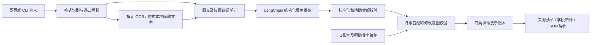

# 系统架构与证据边界

## 数据流程

## 模块职责

| 模块 | 职责与限制 |
|---|---|
| `parsers/` | 按真实格式解析 EML、附件、PDF、图像、Excel、Word，登记父子来源和页面/单元格位置 |
| `ocr/` | 按题目接口传入可下载 URL；保留原始响应、内容哈希、调用状态及超时的不确定性 |
| `extraction/` | 通过 LangChain 提出结构化候选；逐字段核对引用是否来自允许的原文单元 |
| `domain/` | 费用别名、币种、付款方式、Decimal 金额、税/合计勾稽、带依据的 AR/AP 判断 |
| `reconciliation/` | 按组合身份匹配旧账，限制明确授权修改，保留旧值及扩展字段，避免同名费用误合并 |
| `pipeline/` | 串联状态、缓存身份、有限模型结构修复、四类操作、逐来源清单及精确产物哈希 |
| `harness/` | 先预测后读取标签，按来源位置一对一评分、检查完整账本、风险与幂等性 |
| `web/` | 本机上传、单工作线程队列、进度、证据、下载、人工跟进和历史；复用同一 pipeline |

## 业务决策和证据

模型负责提候选，不直接修改账本。`CREATE` 需要费用身份及金额、币种、记账主体和方向明确；`UPDATE` 还需匹配唯一旧账及逐字段修改证据；`NO_CHANGE` 保留已有账及来源身份；信息不足或冲突进入 `PENDING_REVIEW`。

每条费用保留原始与规范名称、原始付款描述、来源位置及引用。更新记录只保存授权字段差异，其余字段继承原快照；缺失字段不代表要求清空。清关指令不等同清空账单字段。审计说明提供可核对依据，不要求模型暴露冗长内部推理。

指定 OCR 的结构化字段独立记录为供应商结果，不冒充页面原文。PDF 原生文字和本地辅助识别也记录各自来源，识别不确定或交易关系缺失时维持复核。

## 运行与配置

默认离线，CLI 仅显式 `--env-file` 加载本机配置。网页启动器显式加载项目 `.env`，API 只返回配置是否齐全，不发送密钥。服务仅监听 loopback，限制可信 Host、同源请求、写请求会话令牌、大小和文件格式；下载按允许列表并验证产物哈希。

每个网页任务独立保存输入、缓存与结果。最多三个排队/运行任务，单线程依次执行，避免并行写同一账本。多个任务接续相同旧账不构成中心账本并发事务；生产接入应另行设计事务提交和冲突控制。

远程模型/OCR 超时不等于服务端未处理，因此不自动重提整票。模型只对结构错误做有界修复。重启将未完成任务标记为中断，保留历史，不在未知外部状态下静默续跑。

## 评测和版本

评测分别保存原始输入、固定配置、独立预期、模型归档、预测和评分。场景通过率、费用行 precision/recall、字段准确率、操作准确率、自动正确完成率、风险拦截和幂等性有各自分母；全部待复核不能替代可自动处理用例。

阶段 8 的三轮真实模型和留出验收对应其冻结版本。后续网页及修复不会覆盖那份记录；阶段 9 使用当前代码做回归与交付验收。固定 OCR、助手编写标签和小样本版式是评测边界，不等同生产整体准确率。

## 后续扩展

本项目交付形态是单机工具。多人使用需要身份认证、权限、持久队列、共享账本事务、人工批准流水、加密与保留策略。当前人工备注仅作为独立跟进记录，不代替这些能力。
